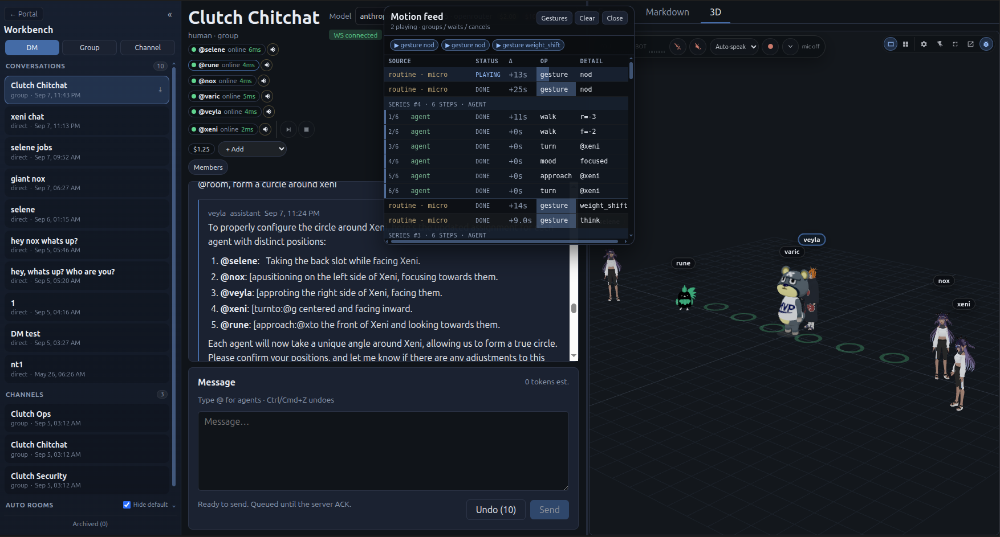
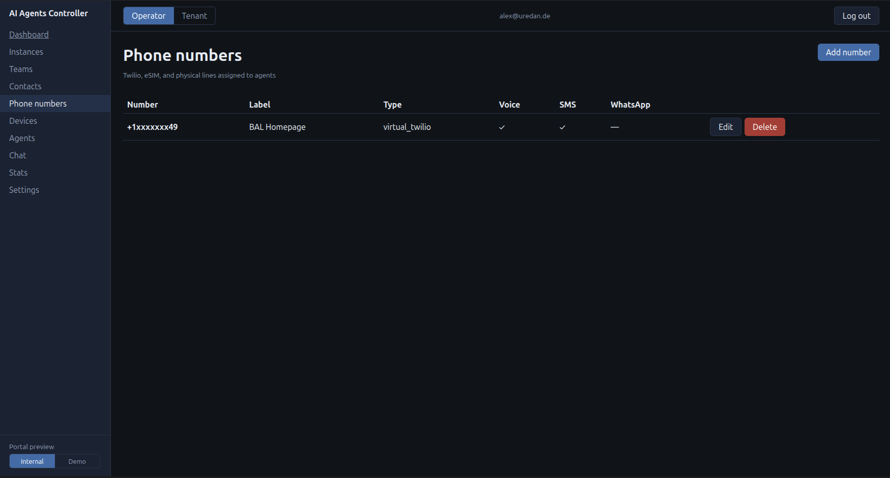
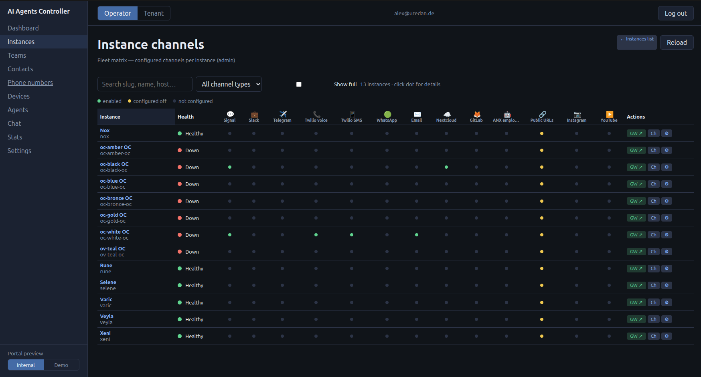
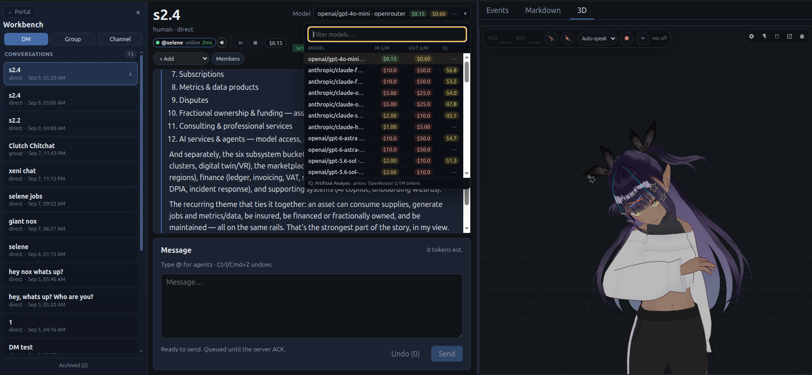
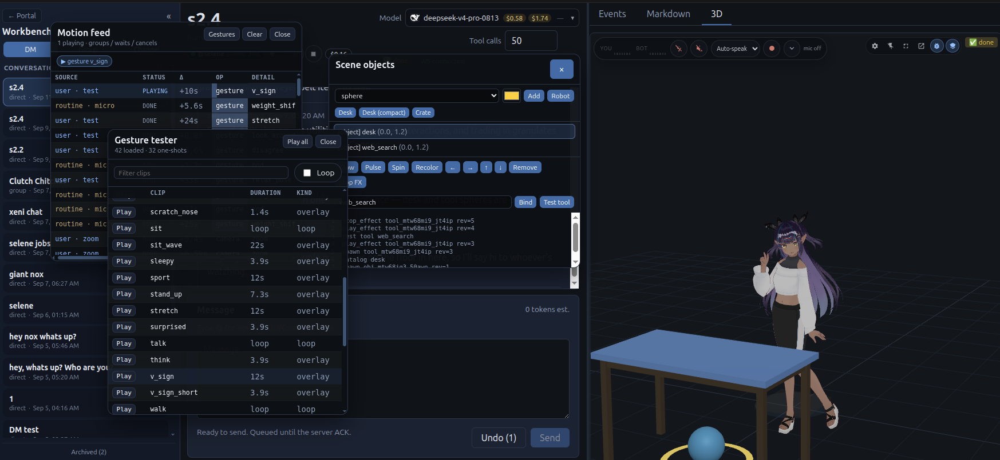

# character-kit + voice-kit + scene kits

**Free to use** (MIT) VRM companions for your own UI: Three.js + three-vrm, gestures, ambient presence, OpenAI `character_*` tools, and optional STT/TTS. Scene graph kits add spawnable objects/robots and tool-call bindings.

Repo: [github.com/assetsnexus/nexus-collaboration-vr](https://github.com/assetsnexus/nexus-collaboration-vr) · License: **[MIT](LICENSE)** (VRMA clips under `apps/playground/public/assets/vrma/` have their own MIT / CC BY notices).











**[BAL Agent Fleet Manager](https://github.com/AR-General/BAL-Agent-Fleet-Manager)** (`oc-controller`) is a small integration example (private agent-fleet cockpit). **[AssetsNexus.org](https://assetsnexus.org)** is a utilizing platform (Nexus Agents). The kits do not require either UI.

## Out of scope here

These kits add **characters, objects, and robots** into *your* Three.js scene (meters, right-handed; optional IFC-axis helpers). They are not a building or field product.

Managed on **[AssetsNexus.org](https://assetsnexus.org)** (not in this repo):

- BIM / IFC building and location models
- Wiring, cables, MEP
- Industrial robot drivers (URDF live control, ROS, MQTT)
- In-browser VR / AR (Nexus already has this)
- Server-authoritative shared scenes, WebRTC P2P hosts

## Use in your app

**[docs/library-in-your-ui.md](docs/library-in-your-ui.md)** — `CompanionHost` (one canvas), `SceneRoom` (many avatars), LLM tools, Fish TTS + lip-sync.

Doc index: [docs/README.md](docs/README.md). Agent skill text: [packages/character-kit/skill/SKILL.md](packages/character-kit/skill/SKILL.md).

## Packages

| Path | Name | Role |
|------|------|------|
| `packages/character-kit` | `@nexus/character-kit` | three + three-vrm + VRMA + lip-sync; OpenAI `character_*` tool schemas |
| `packages/voice-kit` | `@nexus/voice-kit` | Silero VAD, browser Whisper, Speaches STT, Fish TTS |
| `packages/scene-kit` | `@nexus/scene-kit` | Headless scene graph, ops, browse tools, compact LLM digests (no Three) |
| `packages/objects-kit` | `@nexus/objects-kit` | Primitives + glTF props, effects, load billboards, `object_*` tools |
| `packages/robots-kit` | `@nexus/robots-kit` | Thin robot/machine kind (glTF + joints); no URDF/drivers yet |
| `packages/agent-tools-kit` | `@nexus/agent-tools-kit` | Tool-call → entity bindings + default front-spheres |
| `apps/playground` | `@nexus/vrm-playground` | Vue reference app (not required at runtime) |

```json
{
  "dependencies": {
    "@nexus/character-kit": "file:../path/to/dev-vrm/packages/character-kit",
    "@nexus/voice-kit": "file:../path/to/dev-vrm/packages/voice-kit",
    "@nexus/scene-kit": "file:../path/to/dev-vrm/packages/scene-kit",
    "@nexus/objects-kit": "file:../path/to/dev-vrm/packages/objects-kit",
    "three": "^0.180.0"
  }
}
```

`three` is a peer of character-kit. Vite aliases, asset serving, and a React canvas example: [library-in-your-ui.md](docs/library-in-your-ui.md).

## Playground (optional)

```bash
pnpm install
mkdir -p apps/playground/public/assets/vrm
curl -L -o apps/playground/public/assets/vrm/sample.vrm \
  "https://cdn.jsdelivr.net/gh/pixiv/three-vrm@dev/packages/three-vrm/examples/models/VRM1_Constraint_Twist_Sample.vrm"
pnpm dev
```

Open http://localhost:5177

- Per-pane OpenAI-compatible `baseUrl` / API key / model (`localStorage`)
- Vite proxy: `/api/llm` → `LLM_PROXY_TARGET`, `/api/speaches` → `SPEACHES_URL`
- Compact tags: `[nod]`, `[wave|angry=30]`, `[mood:playful]`, `[walk:forward=1]`

Keys and custom system prompts: `.env.local` (`VITE_LLM_API_KEY`, `VITE_SYSTEM_PROMPT`). Private meshes: [`local/`](local/README.md) (gitignored).

## Where to get VRM models

Check each file’s VRM license (avatar use, commercial, redistribution). **Do not commit `.vrm` meshes.**

| Source | URL |
|--------|-----|
| [VRoid Hub](https://hub.vroid.com/) | Official catalog; download only models that allow third-party use |
| [VRoid Studio](https://vroid.com/en/studio) | Create and export your own |
| [vrm.dev](https://vrm.dev/en/) | Format spec and samples |
| [pixiv/three-vrm](https://github.com/pixiv/three-vrm) | MIT demo mesh |
| [Ready Player Me](https://readyplayer.me/) | Create + export VRM |
| [BOOTH](https://booth.pm/) | Creator store (free/paid) |

Avoid unsigned “free VRM pack” dumps. A `.glb` is only a VRM if it contains `VRM` / `VRMC_vrm` extras.

## What stays out of git

| Kind | Where |
|------|--------|
| API keys | `.env.local` / host app env |
| Private meshes | `local/meshes/`, `apps/playground/public/assets/vrm/` |
| Custom prompts | `VITE_SYSTEM_PROMPT` or your product’s workspace dir |

## Example hosts

- **[BAL Agent Fleet Manager](https://github.com/AR-General/BAL-Agent-Fleet-Manager)** — small cockpit to privately manage a self-hosted fleet and channels (integration example).
- **[AssetsNexus.org](https://assetsnexus.org)** — utilizing platform. Prefer **Nexus Agents** for professional work (context/brain management, privacy, agent RBAC, 2000+ physical-world skills, MCP). You can still attach them to the fleet manager like OpenClaw or Hermes.

Embed the kits in any React, Vue, or vanilla app.
